# Active Directory Homelab

Windows Server 2022 Active Directory lab built in VirtualBox: domain controller, DNS, users, OUs, and a domain-joined Windows 10 client.

**Tools:** Windows Server 2022, Windows 10, AD DS, DNS, VirtualBox, PowerShell, CMD

**Skills:** Windows Server administration, Active Directory, DNS, IAM, virtualization, networking, troubleshooting

## Steps

### 1. VM setup
Configured VM hardware, network adapters, and installation media.

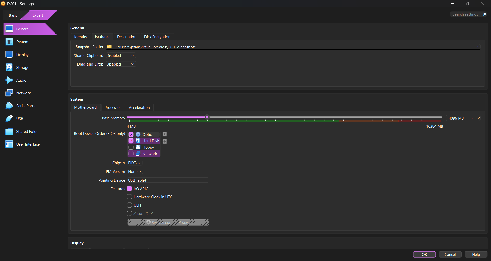
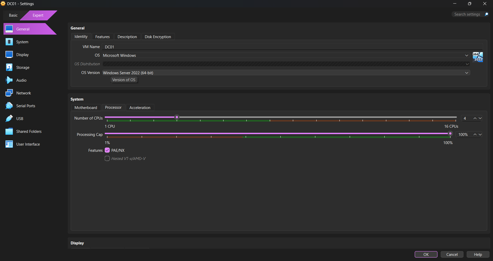
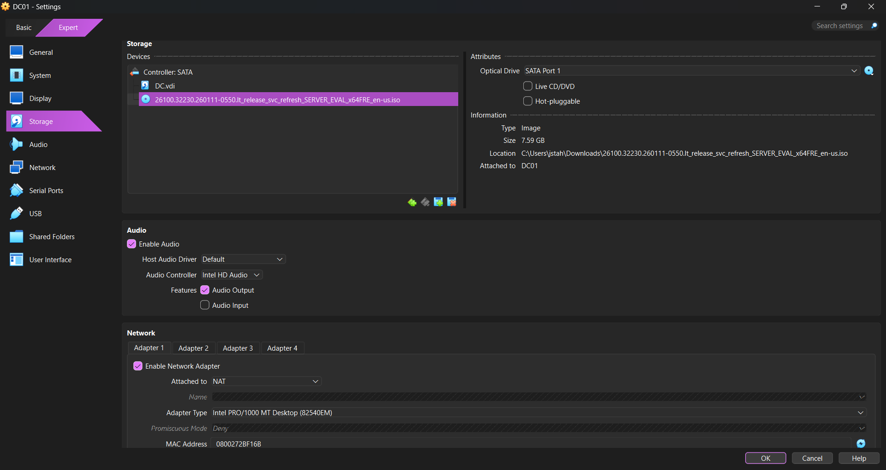

### 2. Windows Server installation

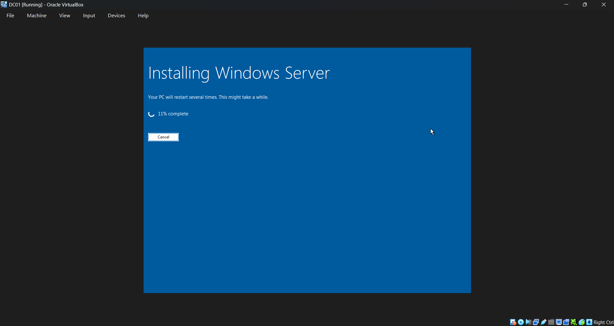
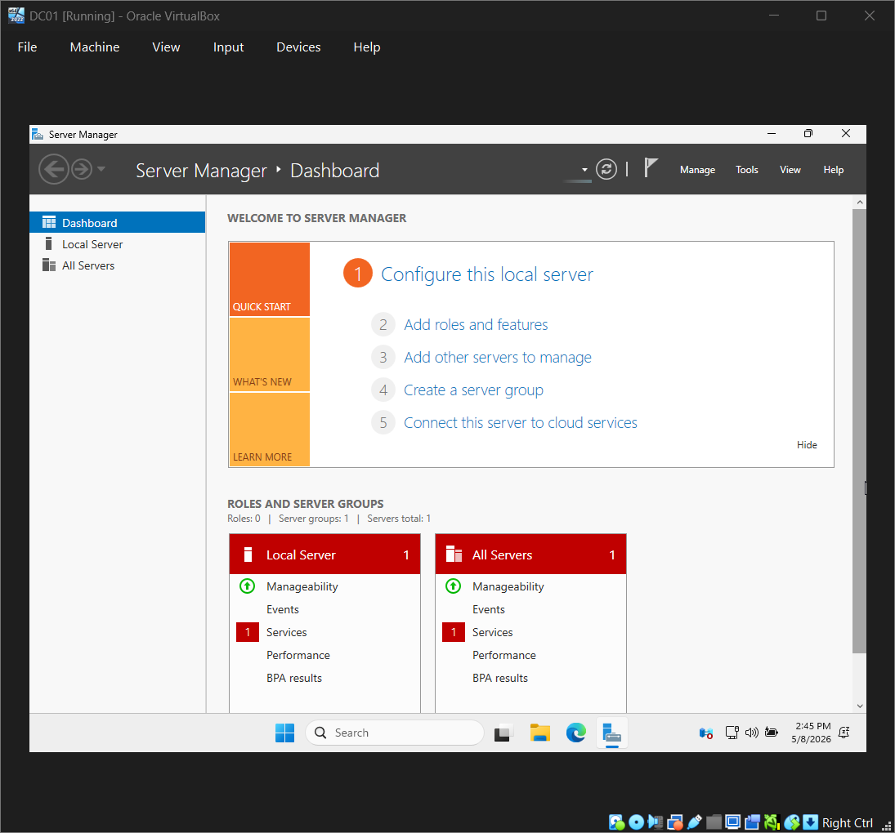

### 3. DC networking
Set static IP and DNS, verified connectivity.

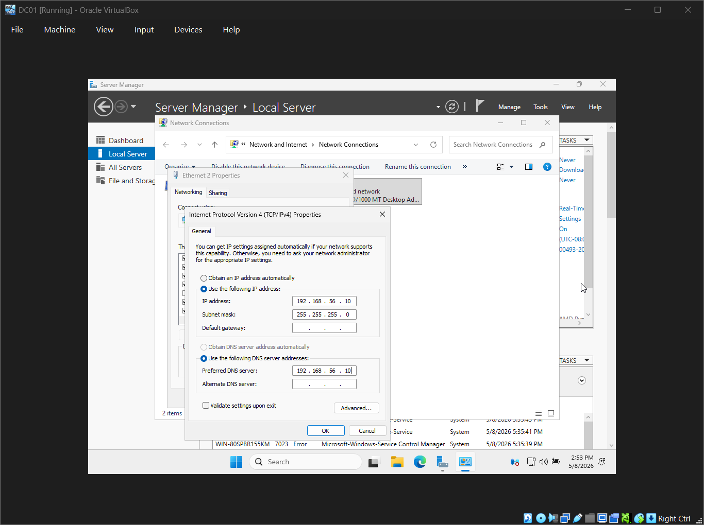
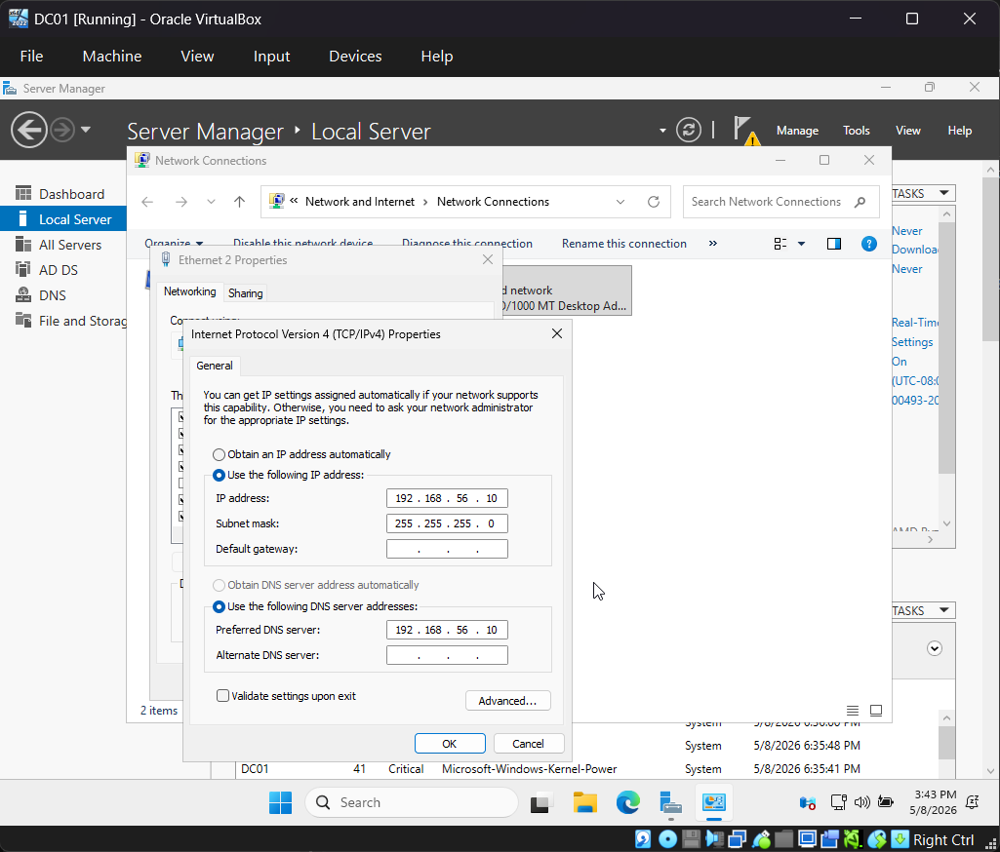

### 4. AD DS installation
Installed AD DS and promoted the server to domain controller.

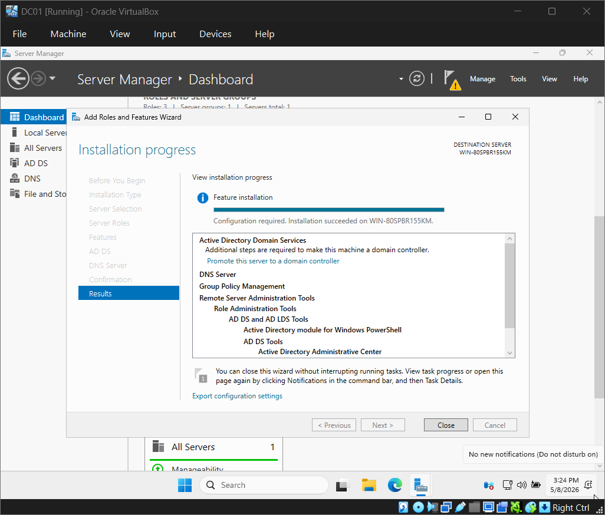
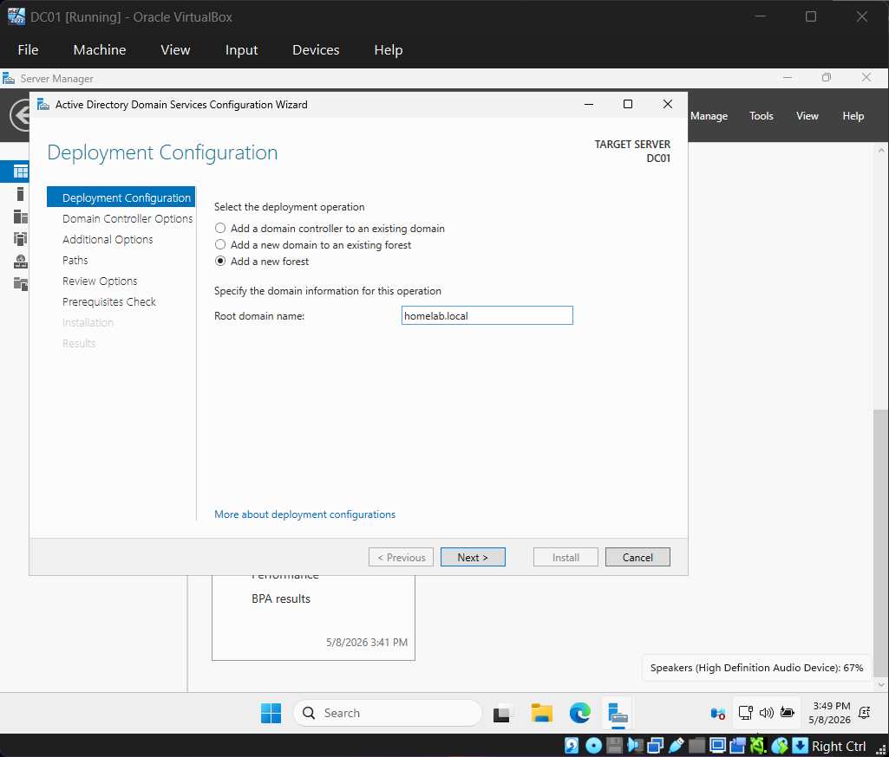

### 5. AD management
Created users and OUs.

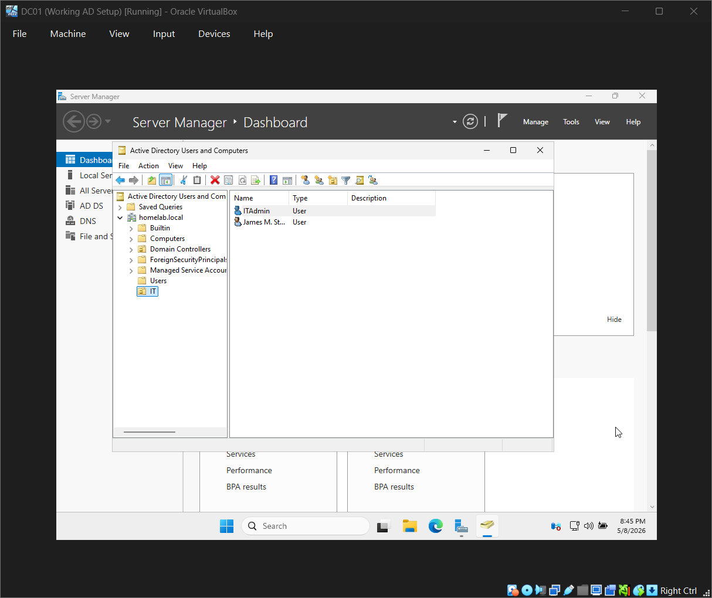
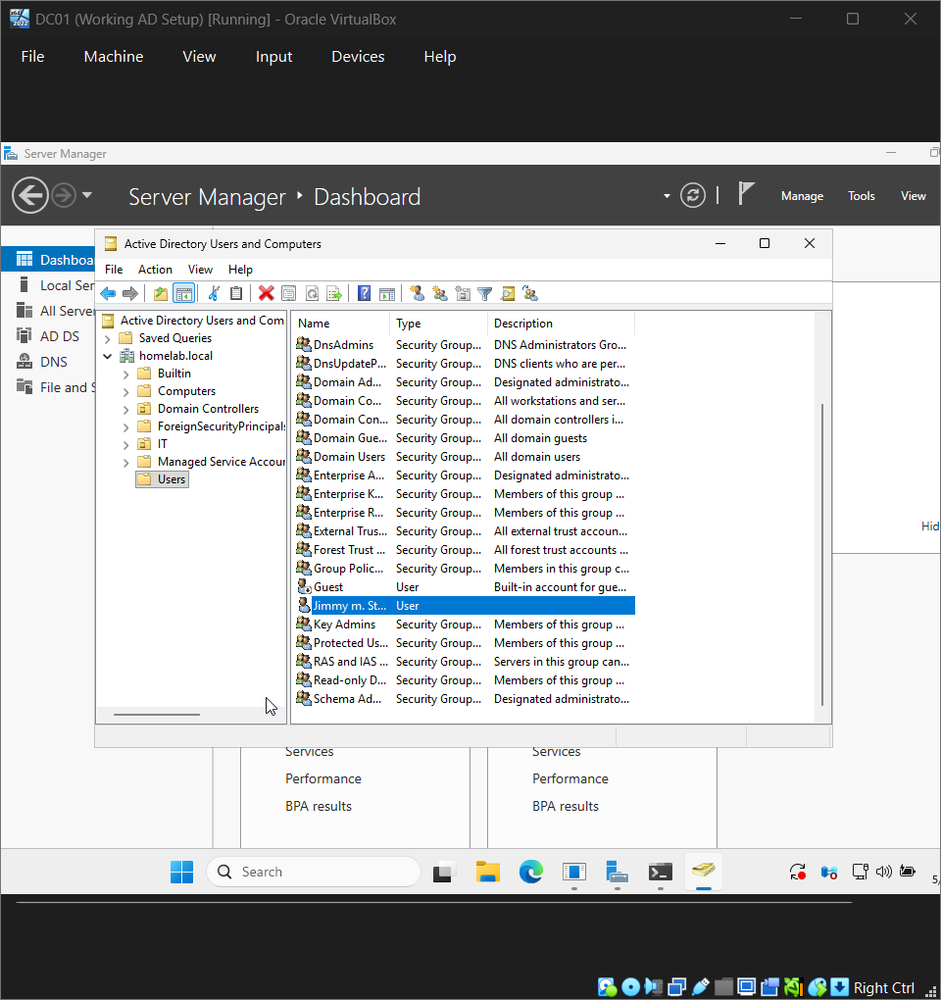

### 6. Domain join and authentication
Joined the client to the domain and verified login with `whoami`.

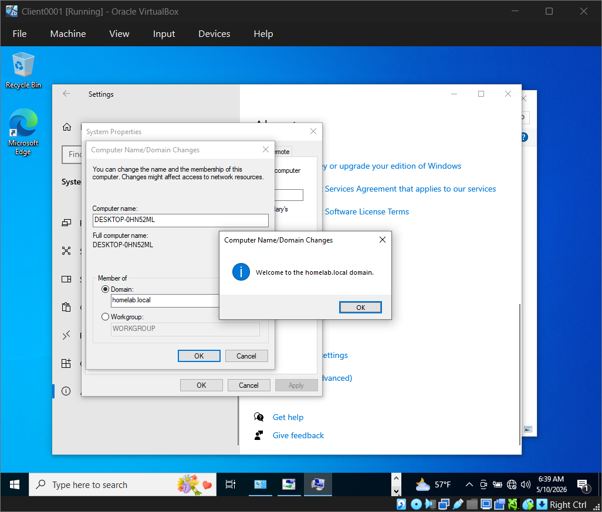
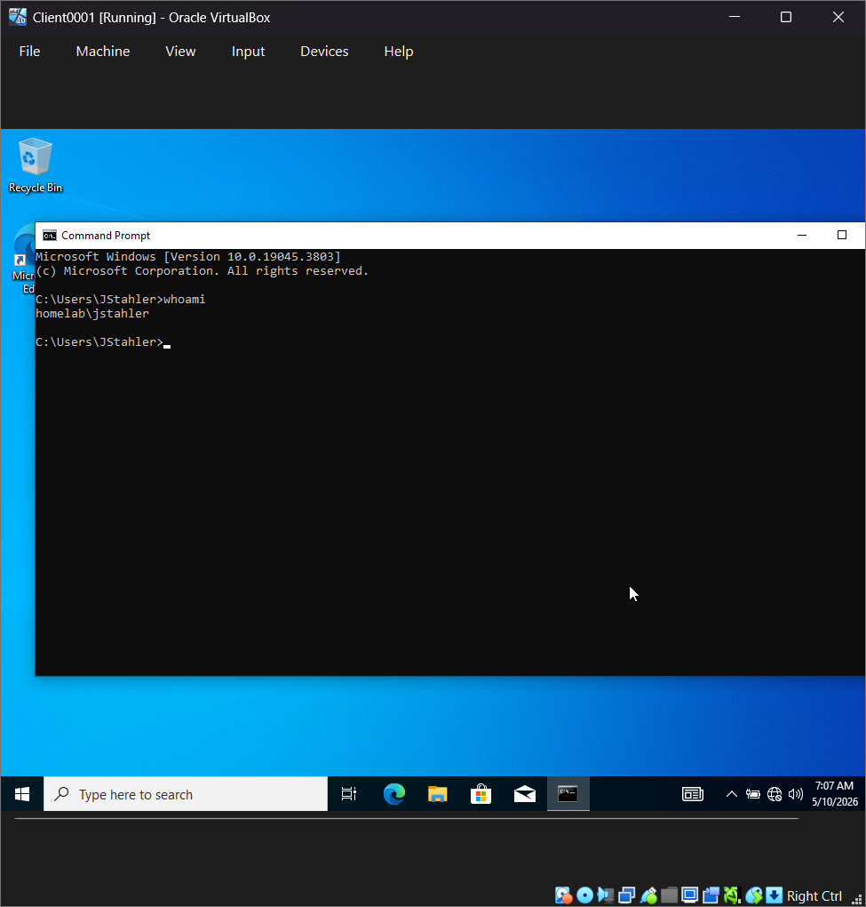

## Next
Group Policy, shared folder permissions, PowerShell automation, security groups, more clients, network segmentation.
